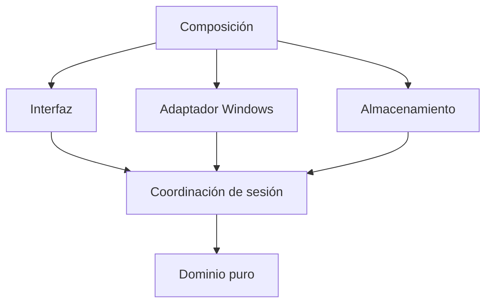

# Arquitectura del producto

**Estado: propuesto; ninguna decisión estructural adoptada.** Plan [6597a51](https://github.com/edu3250/escritorio-canvas/commit/6597a51bb1ee6ad157d88345dd8006d7c6352160), base documental [7f87cf0](https://github.com/edu3250/escritorio-canvas/tree/7f87cf07da4ec3297a2245c7bf4e7c55f80e63ff). Contrato: [tarea](../desarrollo/05-arquitectura/tareas/01-propuesta.md). El [primer incremento](../desarrollo/05-arquitectura/primer-incremento.md) requiere autorización posterior.

## Evidencia y límites

**Observado, según los informes históricos:** [fase 2](../inspeccion/ensayo-panel-nativo.md) obtuvo edición a dos anchos y cancelación de diálogo; [fase 3](../inspeccion/f03-cierre.md) y [fase 4](../inspeccion/f04-cierre.md) conservaron dos acomodos en recorridos controlados. La fase 4 usó Windows 11 25H2 26200.9974, 96 DPI, SDK 10.0.401, Windows Desktop 10.0.12 y VS Code 1.147.0. No se repitió ningún ensayo en esta entrega.

**Confirmado en código por las revisiones históricas:** captura por valor, comprobación de identidad y restauración individual; véanse los SHA y dictámenes de los cierres enlazados. La [inspección CWC](../inspeccion/informe-cwc.md) describe exclusivamente c89634a43fe659482f9e6c7c97f5ed89b94fd701. No se ha inspeccionado otra revisión ni copiado código.

**Inferido:** separar navegación y efectos permite probar el modelo sin Windows. Dos ventanas a 96 DPI no validan otras aplicaciones, escalas, carga o recuperación tras caída. **Pendiente:** adopción de esta propuesta y todos los ensayos de producto.

## Límites y propiedad del estado

Propuesta de un proceso local, sin servicios distribuidos. Las interfaces de efectos pertenecen a coordinación; sus implementaciones reciben órdenes y devuelven observaciones.

Las flechas representan dependencias de compilación, no flujo temporal. Composición inyecta adaptadores; coordinación nunca referencia sus implementaciones.

| Módulo propuesto | Estado del que es dueño | Contrato y responsabilidad |
| --- | --- | --- |
| Domain | Space, Canvas, Home, Panel, Shortcut y navegación inmutable | Validar identificadores, geometría y transiciones; sin HWND, disco ni reloj global. |
| Session | Sesión activa, operaciones y asociaciones vivas | Serializar comandos, reconciliar observaciones, última ventana por aplicación y espacio; puertos IWindowGateway e ISessionStore. |
| Windows | Recursos DWM, suscripciones y referencias nativas | Enumerar, validar identidad, solicitar geometría/foco y medir resultado. Convertir unidades en el borde. |
| Storage | Documento versionado y generaciones confirmadas | Cargar, validar, migrar y guardar instantáneas; no guardar contenido de aplicaciones. |
| UI | Selección visual y formularios transitorios | Mostrar instantánea y errores; emitir comandos. No duplicar cámara ni estado de sesión. |

## Modelo e identidad

Derivado del [diseño](../diseno-inicial.md), [ADR 001](../adr/001-archivos-y-accesos.md) y [ADR 002](../adr/002-sesion-y-reapertura.md).

- `SpaceId`, `PanelId`, `ShortcutId` y `ApplicationId`: identificadores persistentes opacos. `Space` posee nombre, referencia de carpeta, fondo, `Home`, `Canvas` y paneles. Una ventana solo se asigna a un espacio.
- `Canvas` posee `Camera(Position, Zoom)` y geometría mundial. `Home` es una región fija de ese mundo con iconos; no una capa fija de pantalla. `ReturnView` guarda cámara y zoom por espacio, una sola vez por visita a Inicio.
- `Panel` posee `CanvasBounds`, `NativeSize`, `ReopenPolicy` y descriptor persistente de aplicación/ventana. `Shortcut` distingue destino de aplicación, acceso a contenido externo y referencia a contenido del espacio. Navegar nunca mueve archivos.
- `LiveWindowRef` contiene token de sesión, HWND, PID y generación observada; vive solo en Windows/Session. Ni HWND ni PID son identidad durable. `DesktopPlacement` conserva estado normal/maximizado y coordenadas nativas etiquetadas; nunca se interpreta como geometría del lienzo.
- `LastUsedWindow` se indexa por `(SpaceId, ApplicationId)` y solo cambia tras activación observada. Si desaparece, se elimina esa referencia; el selector muestra las supervivientes, sin inventar una última. El menú permite elegir otra o pedir una nueva.

Al recuperar: enumerar primero, validar candidatos y reservar cada ventana como máximo para un panel. Descriptor de aplicación y pistas de instancia ayudan, pero título o PID no bastan. Coincidencia única verificable permite asociar; cero candidatos permite lanzar solo con autorización persistida; varias coincidencias dejan `NeedsChoice`, sin selección automática ni lanzamiento. Cada petición lleva `LaunchRequestId`; mientras esté pendiente no se repite. Tras timeout se reenumera y se pide resolver, no se relanza a ciegas. El juego permanece cerrado salvo elección expresa. Proyecto, pestañas y documentos los recupera la aplicación.

## Coordenadas, estados y efectos

Propuesta: mundo y UI en unidades lógicas de 1/96 pulgada; pantalla en píxeles físicos. Con origen de viewport `o`, cámara `c`, zoom `z` y escala `s = dpi/96`: `screen = o + s*z*(world-c)`; inversa `world = c+(screen-o)/(s*z)`. Redondear solo al pedir geometría nativa y conservar dobles en dominio. Validar finitud, ancho/alto positivos y zoom positivo; límites de zoom concretos son configuración propuesta, no decisión de experiencia.

El zoom cambia la representación del mapa, nunca `NativeSize`. Al editar se proyecta el ancla del panel y se usa su tamaño nativo sin multiplicarlo por el zoom. Si no cabe, se propone ajustar la vista para exponerlo sin reducir automáticamente el tamaño nativo: interacción pendiente de acuerdo. Ampliar es una segunda acción explícita; guarda tamaño y vista anteriores. La aplicación puede imponer mínimos; registrar solicitado y observado, conservar el observado y explicar el límite. No afirmar éxito por el retorno de una llamada.

| Origen / acción | Destino propuesto | Guardas y efectos |
| --- | --- | --- |
| Arranque | Overview del espacio activo | Cargar y reconciliar antes de lanzar. |
| Overview / activar panel | Editing | Guardar acomodo escritorio antes del primer movimiento; pedir posición y foco, comprobar ambos; conservar vecinos visibles. Fallo mantiene mapa accesible. |
| Editing / ampliar | Expanded | Guardar tamaño previo; verificar tamaño aceptado. Volver restaura ese tamaño. |
| Editing / mapa | Overview | Conservar acomodo de lienzo y última activación observada. |
| Navegación / Inicio | HomeVisit | Guardar ReturnView solo al entrar; segunda acción restaura exactamente posición y zoom y consume retorno. |
| Cualquier vista / cambiar espacio | Vista guardada del destino | Guardar cámara del origen; finalizar o revertir operación pendiente antes de aplicar destino. No trasladar contenido. |
| Canvas / escritorio | Desktop | Guardar acomodo Canvas y restaurar DesktopPlacement de cada ventana válida. |
| Desktop / volver | Canvas | Capturar cambios hechos en escritorio como nuevo acomodo escritorio; aplicar Canvas sin sobrescribirlo. |
| Salida normal | Closing / Closed | Cancelar órdenes nuevas, restaurar individualmente, guardar estado confirmado y liberar recursos; jamás terminar aplicaciones reales. |
| Caída | Estado desconocido | Próximo inicio ofrece diagnóstico y reconciliación; no prometer restauración automática. |

Un modal pertenece al panel de su propietario y no crea otra identidad persistente. Durante el modal se propone aplazar cambios de espacio solicitados por el gestor; no bloquear acciones de Windows. Una activación externa de ventana conocida lleva a su espacio tras validación; una desconocida no se asigna automáticamente. Discord y juegos requieren ensayo específico. Un juego a pantalla completa conserva presentación y se representa con indicador, sin moverlo.

Cada operación recibe generación y estado `Requested/Observed/Failed/Partial`. Eventos Win32 entran en una cola serial con identidad y generación; los tardíos invalidan o actualizan observaciones, nunca completan otra operación. Revalidar antes de cada efecto; ante desaparición cancelar y conservar panel desconectado. La reversión es por ventana: si una restauración falla, continuar las demás, mostrar cuáles quedaron pendientes y ofrecer reintento tras nueva lectura. Mantener salida al escritorio disponible, sin bucles de foco ni procesos terminados.

Microsoft documenta restricciones incluso cuando se cumplen condiciones de [SetForegroundWindow](https://learn.microsoft.com/en-us/windows/win32/api/winuser/nf-winuser-setforegroundwindow). Por ello se verificará el primer plano efectivo. Las [miniaturas DWM](https://learn.microsoft.com/en-us/windows/win32/dwm/thumbnail-ovw) son relaciones dinámicas de representación: no prueban interacción nativa. Fuentes consultadas el 18-11-2026.

El producto permite asignar ventanas existentes por decisión del usuario. La automatización de ensayos solo tocará procesos creados por esa ejecución, identificados por PID y archivo/perfil propio, sin administrador. La terminación descartable de fase 4 no autoriza cerrar aplicaciones al salir del producto.

## Alternativas y dependencias propuestas

Los costes siguientes son inferencias cualitativas, sin mediciones de implementación.

| Opción | Beneficio | Coste y condición |
| --- | --- | --- |
| CWC completo | Mapa ya construido según inspección histórica | Alto acoplamiento a shell, elevación y ciclo de activación; incompatible con adoptar sin rediseño. |
| Extracción selectiva | Cámara y descarte geométrico delimitables | Revisar dependencias y conservar licencia MIT y atribución Devnova; aprobación antes de incorporar. Recomendación histórica de la inspección. |
| Código propio, recomendado para el corte inicial | Dominio pequeño sin arrastre del prototipo | Más trabajo propio y pruebas; reconsiderar extracción cuando exista una pieza concreta comparable. No cambia un ADR. |
| WPF, recomendado para futura UI | Microsoft ofrece layout, controles y enlace de datos en Windows | Dependencia estructural propuesta; integración nativa/DWM aún requiere ensayo. [Documentación primaria](https://learn.microsoft.com/en-us/dotnet/desktop/wpf/overview/). |
| WinForms | Familiaridad demostrada por el prototipo | Inferimos más composición manual del lienzo; alternativa si WPF complica interop. No trasladar prototipo al producto. |
| JSON local versionado, recomendado | Documento pequeño inspeccionable, sin motor adicional | Diseñar validación, generaciones y recuperación; concurrencia limitada a un escritor. |
| Base relacional local | Modelo de consultas más amplio | Motor y paquete adicionales por aprobar; no justificados aún por este corte. |

Dependencias propuestas: C#/.NET, Windows Desktop/WPF para UI futura y APIs públicas Win32/DWM encapsuladas. Sin Explorer privado, elevación, CsWin32 ni Vortice por defecto. Primer corte: .NET y consola; xUnit, Microsoft.NET.Test.Sdk, xunit.runner.visualstudio y coverlet.collector sujetos a aprobación y fijación de versiones compatibles. No instalar nada en esta fase. Microsoft describe cobertura con [xUnit y Coverlet](https://learn.microsoft.com/en-us/dotnet/core/testing/unit-testing-code-coverage); no se incorpora su código de ejemplo.

## Persistencia y contenido

Propuesta `SessionDocument(schemaVersion, generation, spaces, panels, preferences)`. Guardar cámaras, retorno, accesos, descriptores, tamaños y autorización separada de reapertura. Excluir handles, estado interno de aplicaciones y secretos. Un diario de recuperación puede guardar observaciones nativas con sesión y contexto DPI, pero nunca usarlas como permiso para operar tras reiniciar.

Un escritor genera temporal en el mismo directorio, valida su lectura, conserva última generación válida y publica reemplazo; el mecanismo concreto y durabilidad ante corte eléctrico requieren ensayo posterior. Al cargar, validar versión, referencias y geometría. Datos corruptos se preservan para diagnóstico; ofrecer copia válida sin sobreescribir el original. Versión futura abre diagnóstico sin escritura; migraciones producen copia nueva. Escritura interrumpida elige la generación completa válida, no mezcla documentos.

La raíz del contenido sigue pendiente de elección explícita. Carpeta ausente: marcar espacio sin contenido accesible y ofrecer relocalizar; nunca crear una sustituta silenciosa. Cambio de ruta del contenido actualiza la referencia solo tras confirmar éxito. «Crear acceso aquí» conserva destino externo; «Mover a este espacio» requiere operación de archivos aparte con resultado verificable y fallo parcial visible. Ni metadatos del gestor ni sus copias contienen documentos del usuario.

## Trazabilidad y riesgos

Estado de las pruebas futuras: **pendiente**. Las tablas anteriores especifican contratos, no resultados de ejecución.

| Requisito | Módulo/contrato | Prueba prevista | Estado |
| --- | --- | --- | --- |
| Espacios y contenido, ADR 001 | Domain/Space, Storage | Navegar no mueve; traslado fallido conserva referencia válida | Pendiente, sin producto |
| Cámara, Inicio y retorno | Domain/Navigation | Ida/vuelta exacta con zoom y aislamiento entre espacios | Pendiente; primer incremento |
| Última ventana y selector | Session/LastUsedWindow | Dos ventanas, cierre de última y selección expresa | Pendiente |
| Edición y ampliación | Windows/IWindowGateway | Tamaño real, modal, vecino y segunda acción | Pendiente; fase 2 solo antecedente |
| Dos acomodos | Session/DesktopPlacement | Normal/maximizada, escritorio y vuelta sin deriva | Pendiente; fases 3–4 solo antecedente |
| Reapertura, ADR 002 | Session/ReopenPolicy | Existente única, ambigua, timeout y juego cerrado | Pendiente |
| Salida y caída | Session + Storage | Fallo parcial y escritura interrumpida descartable | Pendiente |
| Foco externo y atajos | Windows + UI | Notificación real y combinación ocupada con alternativa | Pendiente |
| Rendimiento | UI + Windows | 15 ventanas, seis visibles, Unity; comparar con línea base | Pendiente |

Prioridad: (1) foco externo/modal, para no dirigir entrada equivocada; (2) juegos, para conservar pantalla completa; (3) DPI distintos, para evitar deriva y tamaños erróneos; (4) caída y restauración parcial, para mantener ventanas accesibles; (5) rendimiento, midiendo latencia de activación, tiempos de cuadro, CPU/GPU y memoria frente a misma carga sin gestor. No hay presupuesto numérico aprobado ni estimación fiable de duración. Registrar entorno y versiones en cada ensayo posterior.

## Decisiones para el usuario después de Revisión

| Decisión pendiente | Recomendación | Alternativa y consecuencia |
| --- | --- | --- |
| Reutilización | Dominio propio en corte inicial | Extraer CWC implica revisión por pieza, licencia y atribución. |
| Plataforma | .NET, futura UI WPF | WinForms reduce novedad respecto del ensayo, exige evaluar composición. |
| Datos | JSON versionado y un escritor | Motor local añade dependencia y complejidad. Raíz del contenido se elige aparte. |
| Navegación al editar y modal | Exponer tamaño nativo y aplazar cambios durante modal | Rechazar entrada si no cabe o permitir cambio con modal exige acordar interacción y ensayarla. |
| Iniciar producto | Aprobar por separado primer incremento y paquetes/versiones | Mantener documentación sin ejecución hasta resolverlos. |

## Validación documental

Criterios del encargo: responsabilidades, modelo, transiciones, alternativas, primer incremento y decisiones **verificados documentalmente** en las secciones anteriores y documento enlazado; no equivalen a validación del producto. Revisión independiente **pendiente**. Comprobaciones mecánicas y esfuerzo se registran en el PR de entrega.
